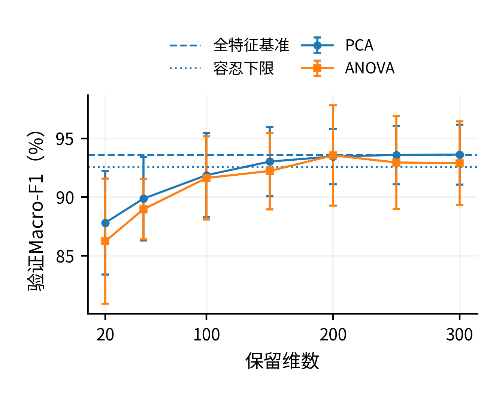
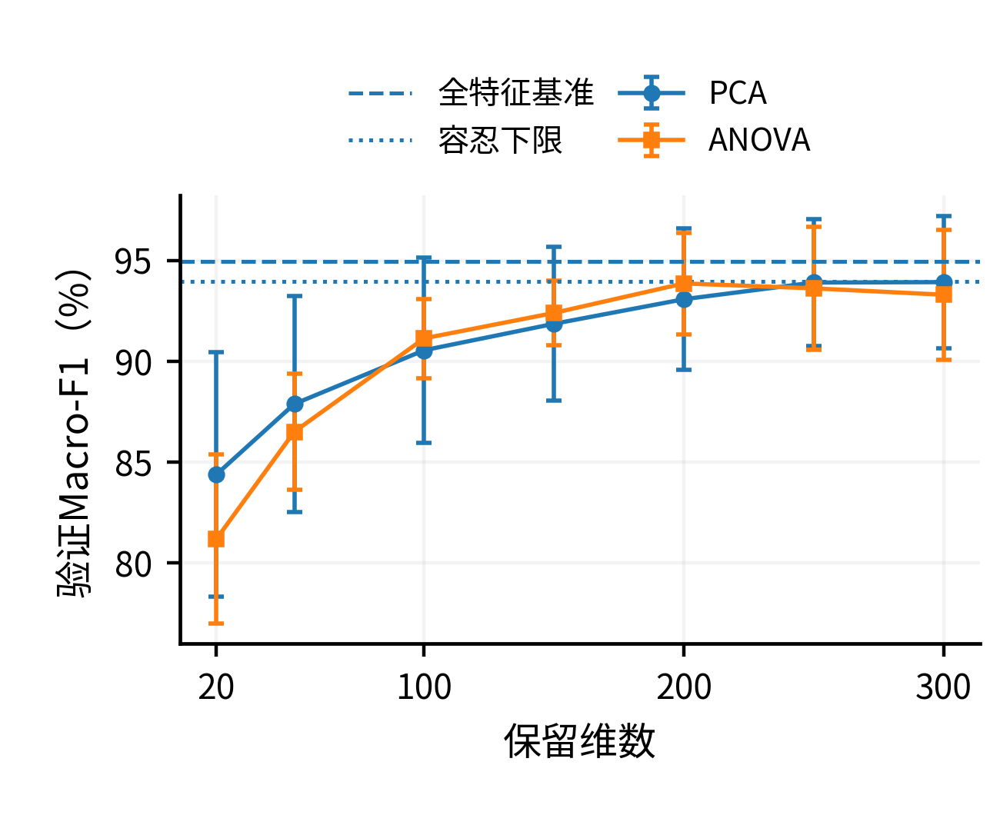
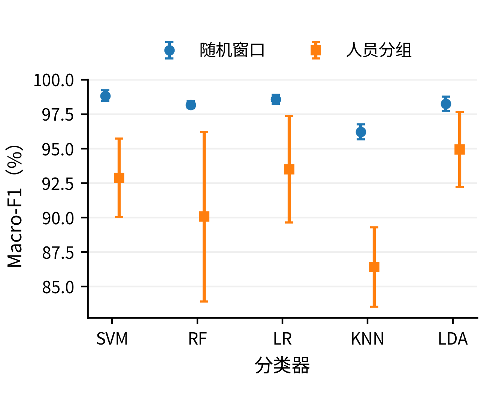
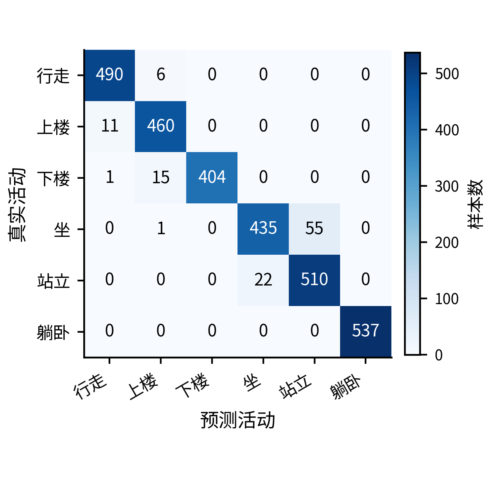
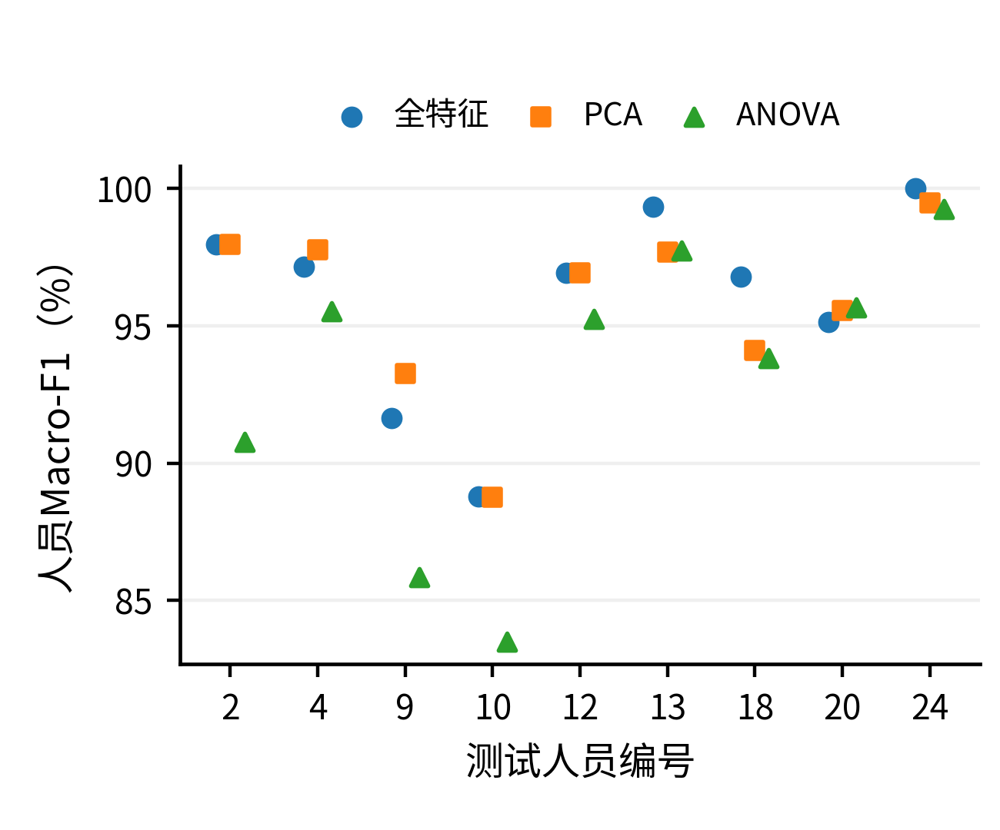
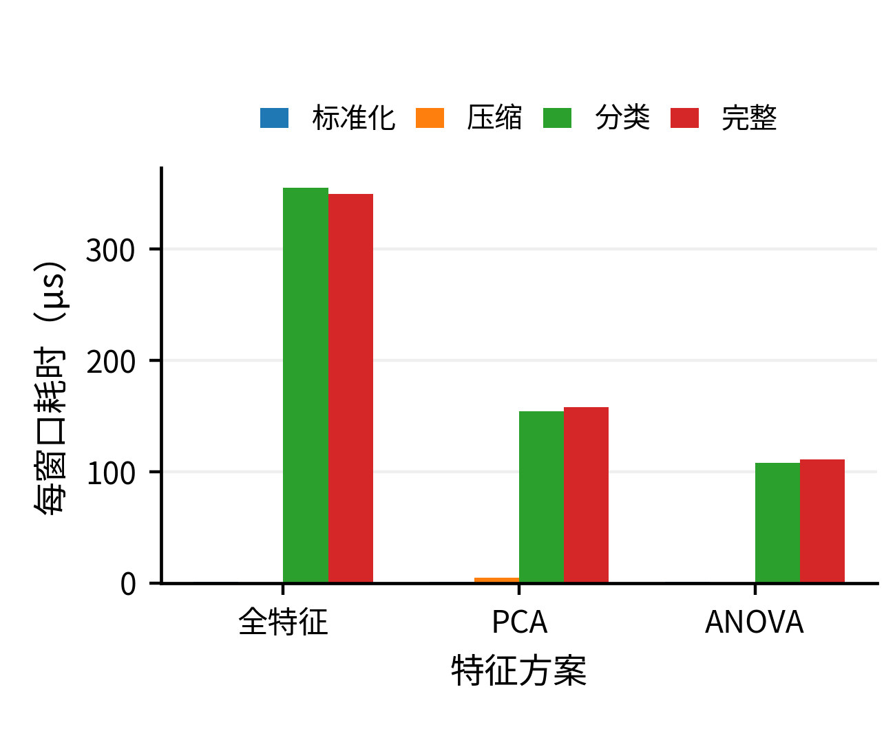
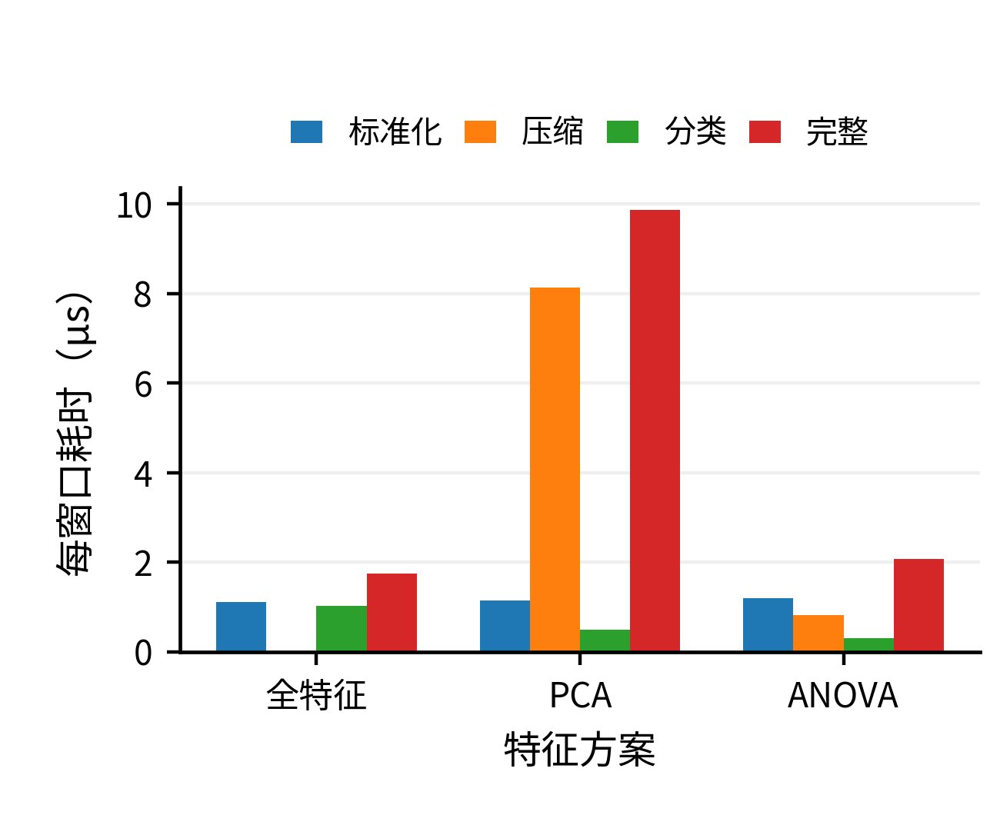
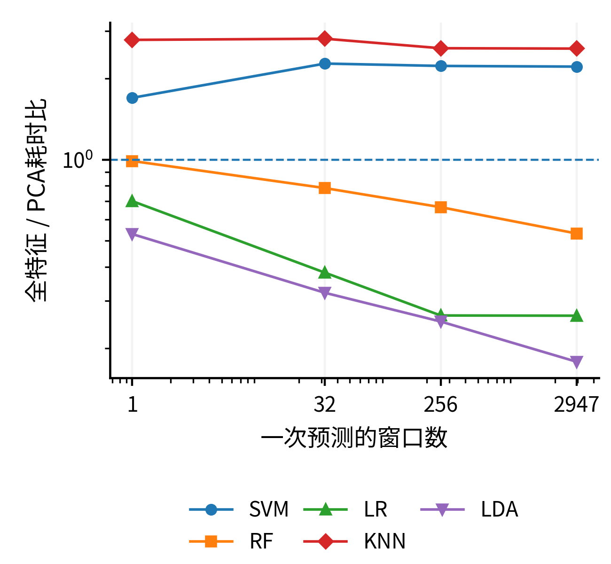

# 面向跨人员泛化的智能手机人体活动识别与特征压缩研究

作者姓名、单位与学号待填写。

## 摘要
针对智能手机人体活动识别中人员依赖评价偏差以及特征压缩未必降低整体开销的问题，在UCI HAR官方21名训练人员与9名测试人员隔离的条件下，比较支持向量机、随机森林、逻辑回归、K近邻和Fisher线性判别分析。采用全561维、主成分分析和ANOVA筛选三条路径，在训练人员五折验证中评估480个候选，按相对全特征Macro-F1下降不超过1个百分点的规则选择压缩维数。锁定配置后测量分类成绩、逐人员表现、模型体积，并在1、32、256、2947窗口批量下分别测量标准化、变换、分类与完整预测。结果表明，全特征FisherLDA的测试准确率与Macro-F1分别为96.23%和96.26%。在2947窗口批量下，PCA相对同分类器全特征的预测加速比分别为SVM的2.21和KNN的2.58，但其余方案中共有3个分类器的PCA完整预测变慢。压缩收益依赖分类机制与批量规模，验证达标不保证新人员测试达标。研究支持将预测性能、人员差异和完整管线成本联合评价，而非仅根据维数下降推断轻量化成功。

## Abstract
Smartphone human activity recognition requires both reliable predictions for previously unseen people and a realistic assessment of computational cost. A smaller feature vector does not necessarily imply a faster deployed prediction pipeline, because a learned transformation must itself be executed. This study compares RBF support vector machines, random forests, logistic regression, k-nearest neighbors, and Fisher-type linear discriminant analysis on the official UCI HAR subject-disjoint split. The training partition contains 7,352 windows from 21 participants, while the test partition contains 2,947 windows from nine different participants. The supplied 561-dimensional engineered features are used directly; raw inertial feature extraction is outside the measured scope. For each classifier, full features are compared with principal component analysis and ANOVA-based feature selection. Seven compressed dimensions, 20, 50, 100, 150, 200, 250, and 300, are evaluated. All newly fitted preprocessing is restricted to the training subjects of each fold. The complete search consists of 480 configurations and 2,400 grouped cross-validation fits. For each compression route, the smallest evaluated dimension whose mean validation macro-F1 is within one percentage point of the tuned full-feature baseline is selected. If no dimension qualifies, the best validation configuration is retained explicitly as a failed diagnostic route rather than silently accepted. All final configurations are locked before loading the test arrays. A separate fixed-parameter comparison illustrates the difference between random-window and subject-grouped evaluation without attributing the entire gap to a single causal factor. In addition to aggregate and per-participant classification metrics, complete saved-pipeline size and prediction cost are recorded. Timing uses one computational thread, three warm-up calls, and 15 interleaved repetitions at batch sizes of 1, 32, 256, and 2,947. Standardization, dimensional transformation, classifier prediction, and complete-pipeline prediction are measured separately. Independently measured stage medians are not treated as an exact additive decomposition. The full-feature FisherLDA obtains 96.23% accuracy and 96.26% macro-F1 on the fixed test participants. At the largest batch size, PCA yields speedup ratios of 2.21 for SVM and 2.58 for KNN relative to their own full-feature baselines; PCA increases complete prediction time for 3 of the five classifiers. The findings indicate that feature compression is a classifier-dependent performance–cost trade-off, not a universally beneficial acceleration step. The study preserves unsuccessful configurations and individual-participant variation. Because the same official test set was examined in earlier project iterations, this rerun is an exploratory extension rather than a new independent confirmation. No claims are made about statistical superiority across all users, raw-signal extraction savings, mobile-device power consumption, or cross-device generalization.

## 1　引言

基于智能手机惯性传感器的人体活动识别，可以把连续运动信号转化为离散的活动类别。与图像识别不同，该任务不需要直接采集用户外观，而是使用加速度、角速度等信号描述运动状态。UCI HAR通过标准化采集协议提供了六类日常活动及其窗口特征，为比较经典分类器建立了可复用基础[1-2]。本文关注的不是增加一个分类器后能否获得更高的排行榜分数，而是模型在未见人员上是否可靠，以及减少特征后是否真正降低计算开销。

这两个问题不能用普通随机划分和维数统计替代。对于同一人员连续产生的窗口，训练样本与验证样本可能共享人员习惯和局部信号结构。UCI HAR的相邻窗口存在重叠，把所有窗口打散得到的高分不必然代表对新人员的泛化能力；已有研究讨论了重叠窗口与验证协议对评价结果的影响[3]。因此，划分单位应与预期使用对象一致：若目标是未见用户，人员而不是单个窗口才是隔离单位。

特征压缩也存在容易被忽略的代价。主成分分析（principal component analysis，PCA）能够构造较低维的表示[4]，特征选择则保留一部分原始变量[5]。但是，PCA预测时需要额外执行投影；对于本来只需较小线性运算的分类器，投影开销可能超过分类阶段节省的运算。因而“561维降至200维”本身既不能证明加速，也不能证明分类性能保持。

基于上述考虑，本文提出三个实验问题：R1，按人员隔离与随机窗口验证得到的分数有何差异，整体结果是否掩盖人员差异；R2，PCA与ANOVA筛选在不同分类器上能否保持接近全特征基准的性能；R3，在计入标准化、变换与分类后，压缩收益是否依赖分类器及预测批量。实验采用scikit-learn实现[6]，对五个分类器、三条特征路径进行统一人员分组调参，并在测试前锁定参数及维数。

本文的工作是可复现的课程比较研究，不提出新的PCA、Fisher判别或特征选择算法。主要工作体现在统一的人员隔离协议、可追溯的维数选择规则，以及完整预测与分阶段开销的联合分析。所有结果来自本次重新运行；未达标、测试损失超标以及降维后变慢的配置均保留。

## 2　相关工作与研究定位

### 2.1　活动识别数据与人员独立评价

Anguita等构建了基于腰部智能手机的公开活动识别数据集，并给出了特征工程与分类基线[1]。官方版本按照参与者而非窗口随机划分训练、测试部分[2]。本文沿用这一划分，不重新寻找对模型更有利的测试人员，也不把官方文献成绩当成本项目复现成绩。

Dehghani等分析了惯性传感器活动识别中重叠窗口的评价问题[3]。本文据此设置训练集内部的验证协议对照：固定分类器参数，只改变随机窗口划分与人员分组划分。该对照用于刻画两种评价目标的区别；由于验证样本、训练样本数量与人员组成同时不同，分数差不解释为“人员泄漏”的纯因果效应。

### 2.2　特征提取与特征选择的差异

PCA通过方差最大的正交方向表达数据，是无监督线性特征提取方法；保留较多方差并不保证保留最适合分类的方向[4]。ANOVA筛选属于单变量过滤方法，它按照各特征的类别区分统计量排序，不构造新的综合变量。变量筛选的方法种类很多，其目标与约束也不相同[5]。本文采用ANOVA是为了提供计算较低、可解释且能精确指定保留数量的对照，不是因为已经证明它优于互信息、递归消除或稀疏模型。后几类方法未在本次运行，不作为已完成贡献。

### 2.3　不同分类机制下的压缩收益

支持向量机通过间隔准则建立分类边界[7]，随机森林组合多棵随机化决策树[8]，近邻方法根据参考样本的距离关系预测[9]，Fisher思想及线性判别分析提供类间分离与类内散布的线性基线[10]。逻辑回归则以正则化的线性判别分数估计类别概率[11]。本文选择这五类方法，是为了覆盖核模型、树集成、距离模型和线性模型，而不是追求最多的算法数量。

研究的主要增量是将“压缩后的分类表现”与“执行压缩自身的计算代价”放在同一协议下评价。本文既报告每种模型的完整输入基准，也报告压缩路线的失败情况，并区分总体窗口指标、人员等权指标和不同批量的实现开销。

## 3　方法与评价协议

### 3.1　问题定义与人员隔离

记样本集合为D={(xᵢ,yᵢ,gᵢ)}，其中xᵢ∈R⁵⁶¹为官方窗口特征，yᵢ∈{1,…,6}为活动标签，gᵢ为人员编号。官方训练人员集合与测试人员集合不相交。训练集内部采用StratifiedGroupKFold生成五折，在尽量保持类别比例的同时，使每名人员只属于一个验证折[12]。各模型和全部候选共用同一折分配，人员编号只用于分组与事后评价，不进入输入矩阵。

Gₜᵣ ∩ Gₜₑ = ∅，　Gₜᵣ⁽ᶠ⁾ ∩ Gᵥₐ⁽ᶠ⁾ = ∅。　(1)

本项目新增的标准化、PCA和特征选择均放在折内训练流程中。标准化参数只由当前训练人员计算；验证与测试样本使用已经拟合的变换器。此设置避免先用全数据计算变换再交叉验证的预处理泄漏[13]。官方特征文件本身已经经过上游特征提取和归一化，本研究不据此声称审计了原始信号处理的全部步骤。

zᵢⱼ = (xᵢⱼ − μⱼ,ₜᵣ) / σⱼ,ₜᵣ。　(2)

### 3.2　三条特征表示路径

全特征路径只标准化并保留561列，构成每个分类器自己的基准。PCA路径在标准化后，用完整奇异值分解拟合最大候选维数的主成分，取前k个方向构造表示，不使用白化。若Wₖ为对应投影矩阵，则预测变换为式(3)。不同分类器复用同一训练折的变换结果，但每个分类器参数组合仍分别拟合。

Zₖ = (Z − μₚ꜀ₐ) Wₖ，　WₖᵀWₖ = Iₖ。　(3)

ANOVA路径使用SelectKBest(f_classif)。设第c类含n꜀条训练记录，第j个特征的类均值为μ꜀ⱼ、全体均值为μⱼ，其排序分数是类间均方与类内均方的比值。本文仅使用F分数排序，不把重叠窗口上的p值当作可靠的显著性证据；它也不自动消除所选特征之间的冗余。

Fⱼ = [Σ꜀ n꜀(μ꜀ⱼ−μⱼ)²/(C−1)]　(4a)

　　 / [Σ꜀ Σᵢ∈꜀(zᵢⱼ−μ꜀ⱼ)²/(N−C)]。　(4b)

PCA与ANOVA均考察20、50、100、150、200、250、300维。所有候选在运行前写入冻结配置，各模型使用相同的候选维数，不依据本轮测试分数追加搜索。PCA输出是原始变量的组合，而ANOVA输出是原始列的子集，二者的物理解释和部署开销不同。

### 3.3　分类器与超参数

RBF-SVM使用核函数K(x,x′)=exp(−γ‖x−x′‖²)，搜索正则化参数C与γ。RandomForest固定200棵树，调节最大深度和叶节点最少样本数，预测时聚合树的类别概率。其max_features固定为sqrt，因此特征维数变化也会改变每次分裂可考察的变量数。

LogisticRegression使用L2正则化、lbfgs求解器和最大8000次迭代，搜索C。KNN使用暴力欧氏距离搜索，比较邻居数和普通/距离加权投票。FisherLDA使用多类LinearDiscriminantAnalysis，固定lsqr求解器，比较无收缩、自动收缩及三个指定收缩强度；先验由训练折类别比例估计。该模型在本项目中作为分类器，而非额外的监督降维器[14]。

LDA假设各类别共享协方差，分类可用线性判别分数表示为式(5)，Σ†表示广义逆或等价的最小二乘解；数值实现不显式求矩阵逆。六分类LDA的判别投影最多有五个方向，与PCA的20～300维不是同一个概念。这里不调用LDA.transform，也不把200维PCA误解释为200维Fisher投影。

δ꜀(z)=zᵀΣ†μ꜀−½μ꜀ᵀΣ†μ꜀+lnπ꜀。　(5)

### 3.4　训练内选择与失败方案保留

对模型m、特征方法r、维数k和分类器参数θ，先计算五个验证折Macro-F1的算术平均。每个维数分别搜索相同模型网格，不只给压缩路线调参而不给全特征基准调参。记每个维数内的最高平均分为Sₘ,ᵣ(k)，全特征最优分数为Bₘ，选维数规则为式(6)，其中ε=0.01。

k* = min{k∈K : Sₘ,ᵣ(k) ≥ Bₘ − ε}。　(6)

若集合为空，保留验证分数最高的配置用于诊断，并将“验证达标”标记为否；不能把它当成成功压缩。相同分数按固定候选编号处理，不根据测试成绩打破平局。验证分数参与开发期选择，存在选择乐观性；本项目未进行外层嵌套人员交叉验证。所有15个最终配置先写入selection_lock.json，再用完整训练集重新拟合，之后才读取测试数组。

### 3.5　分类与资源评价指标

总体分类表现报告Accuracy、六类Macro-F1和平衡准确率，同时保存逐类精确率、召回率与混淆矩阵。Macro-F1按类别等权，如式(7)；人员等权指标则先为每名测试人员分别计算六类Macro-F1，再取九人的平均，如式(8)。二者不同，不能用总体高分代替对每名用户的检查。

F₁,macro = (1/C) Σ꜀ 2P꜀R꜀/(P꜀+R꜀)。　(7)

F₁,person = (1/9) Σₛ₌₁⁹ F₁,macro⁽ˢ⁾。　(8)

预测资源评价区分完整调用和独立阶段调用。批量B的完整时间为一次Pipeline.predict的墙钟时间；对15次测量取中位数，再除以B得到每窗口平均耗时。相同分类器的全特征/PCA耗时比定义为加速比，大于1才表示PCA更快。模型大小使用统一压缩等级保存的完整Pipeline文件字节数，不将其解释为峰值内存。

t̄(B)=medianᵣ Tᵣ(B)/B，　(9a)

Speedup(B)=t̄full(B)/t̄PCA(B)。　(9b)

分别测量标准化、压缩变换、分类预测和完整流程，阶段输入在计时前准备。独立阶段的中位数不可严格相加为完整流程中位数，因为调用、校验、缓存和分配状态不同。预测批量、模型复杂度及数据表示都会影响实际延迟[15]。本文保持默认输入校验，不通过关闭安全检查制造速度收益。

## 4　实验设置与复现实现

### 4.1　数据集与任务范围

使用UCI HAR官方561维特征版本：30名19～48岁志愿者佩戴腰部Samsung Galaxy SII，采集三轴加速度计和陀螺仪信号；采样频率50 Hz，窗口长2.56 s，相邻窗口重叠50%[1-2]。六类分别为行走、上楼、下楼、坐、站立和躺卧。本项目不重新提取原始惯性特征，不开发手机端应用，也不把本任务称为跌倒检测或疾病诊断。

训练集有7,352个窗口、21名人员，测试集有2,947个窗口、9名人员。两部分人员交集为0。程序按原始列编号保留全部561列，重复特征名称不导致删列；输入文件逐项保存SHA-256。类别数量见表1。

表1　官方人员划分中的窗口样本数
| 活动类别 | 训练集 | 测试集 |
| --- | --- | --- |
| 行走 | 1226 | 496 |
| 上楼 | 1073 | 471 |
| 下楼 | 986 | 420 |
| 坐 | 1286 | 491 |
| 站立 | 1374 | 532 |
| 躺卧 | 1407 | 537 |
| 合计 | 7352 | 2947 |

### 4.2　参数预算与固定对照

随机种子统一为42。每模型有15种特征设置，即全特征1种、PCA7种、ANOVA7种。每种设置分别评估SVM 8组、RF 6组、LR 5组、KNN 8组、LDA 5组参数，共480个候选、2400次主要五折拟合。树数量固定而非搜索；网格规模有限，最优参数碰到边界只作诊断，不在看过测试成绩后自动扩大。表2给出搜索范围。

表2　每种特征设置下的分类器搜索空间
| 模型 | 候选参数 | 组数 |
| --- | --- | --- |
| SVM | C=1,10,100,1000；γ=scale,0.001 | 8 |
| RF | 深度=None,10,20；叶节点最少样本=1,3 | 6 |
| LR | C=0.01,0.1,1,10,100 | 5 |
| KNN | 邻居=3,5,9,15；权重=uniform,distance | 8 |
| LDA | 收缩=None,auto,0.05,0.2,0.5 | 5 |

另在训练人员中固定参数，比较随机窗口分层五折与人员分组五折，共50次拟合。固定参数为SVM的C=10、γ=scale；RF默认不限深度且叶节点最少样本1；LR的C=1；KNN的5邻居普通投票；LDA无收缩。压缩曲线还提供从已评估候选提取的固定参数对照，其中SVM固定C=10、γ=0.001；它与上述验证协议对照的γ=scale不是同一实验，不跨表相减。该对照用于区分逐维数重新调参与表示变化，不能完成纯因果归因。

### 4.3　测时环境与四种批量

本轮在Linux x86-64环境运行，处理器报告为AMD EPYC 9V74，容器可用5个逻辑CPU；Python 3.13.5、NumPy 2.3.5、SciPy 1.17.0、scikit-learn 1.8.0。搜索使用4个进程，底层BLAS/OpenMP限制为单线程；正式预测计时不与网格拟合并行。软件版本和线程池信息随结果保存。虚拟化机器的负载会影响计时，不宣称跨设备绝对延迟保证。

为分析特征变换自身的代价，分别对B∈{1,32,256,2947}测量四阶段，预热3次、重复15次，交错模型及阶段顺序；所有原始计时保存而非只报最佳一轮。输入按固定均匀索引选择，B=1仅取测试窗口0，属于控制微基准，不能代表所有在线用户。原流程另保留64个均匀位置单窗口调用的总体平均计时，两种口径不混用。

阶段统计共3600条原始记录、240行汇总；全特征路线不存在压缩操作，其reduce=0为结构性缺省而非实测零延迟。逐批量比较拆解后的预测与完整Pipeline是否一致。输出均值、分位数和速度比可从原始记录复算。初始特征提取、磁盘读取、模型加载与手机功耗不在测量范围内。

### 4.4　不确定性与证据保存

对于压缩相对全特征的人员Macro-F1差值，以测试人员为单位进行2000次配对Bootstrap，取2.5%与97.5%分位数作为描述性区间。重叠窗口不作为独立重采样单位；只有九名人员且训练模型固定，因此区间不覆盖训练人员重抽样和新地区人群变化，也不作为总体非劣效性的证明。

保留全部候选与逐折分数、训练验证人员索引、测试真值和预测、配置锁、模型文件哈希、完整及分阶段计时。训练入口从空断点重新开始，不混用上传包的旧计时。单元测试验证软件接口与规则，结果核验则独立复算预测指标，二者均不替代外部数据确认。

## 5　分类结果与跨人员分析

### 5.1　最终配置的总体表现

本轮从空检查点完成480个候选的2400次五折拟合，并将15条管线用于官方测试人员。表3将验证选择与测试评价分别列出；ΔF1始终相对于同一分类器的全特征基准，单位为百分点。全特征FisherLDA在五个全特征模型中取得最高测试Macro-F1，为96.26%，准确率为96.23%。这只是本次固定测试人员上的观察，未证明该模型在所有人群上具有统计显著优势。

表3　训练内锁定方案与官方测试集结果（分数单位：%）
| 模型 | 特征方案 | 维数 | 验证F1 | 验证达标 | 测试Acc. | 测试F1 | ΔF1(pp) |
| --- | --- | --- | --- | --- | --- | --- | --- |
| SVM | 全特征 | 561 | 93.568 | 基准 | 95.52 | 95.46 | — |
| SVM | PCA | 150 | 93.030 | 是 | 94.37 | 94.27 | -1.19 |
| SVM | ANOVA | 200 | 93.556 | 是 | 93.62 | 93.60 | -1.86 |
| RF | 全特征 | 561 | 90.215 | 基准 | 92.77 | 92.56 | — |
| RF | PCA | 200 | 86.456 | 否 | 89.18 | 88.77 | -3.79 |
| RF | ANOVA | 200 | 89.658 | 是 | 90.06 | 89.84 | -2.71 |
| LR | 全特征 | 561 | 93.498 | 基准 | 95.52 | 95.50 | — |
| LR | PCA | 200 | 93.169 | 是 | 94.54 | 94.54 | -0.96 |
| LR | ANOVA | 200 | 93.041 | 是 | 93.65 | 93.77 | -1.74 |
| KNN | 全特征 | 561 | 88.015 | 基准 | 89.04 | 88.69 | — |
| KNN | PCA | 150 | 87.496 | 是 | 88.80 | 88.46 | -0.23 |
| KNN | ANOVA | 100 | 87.459 | 是 | 87.34 | 86.90 | -1.78 |
| LDA | 全特征 | 561 | 94.952 | 基准 | 96.23 | 96.26 | — |
| LDA | PCA | 300 | 93.935 | 否 | 95.96 | 95.95 | -0.31 |
| LDA | ANOVA | 200 | 93.870 | 否 | 93.62 | 93.61 | -2.65 |

注：SVM、RF、LR、LDA分别表示RBF-SVM、随机森林、逻辑回归、FisherLDA。验证达标仅指训练人员验证分数达到预设范围，不是最终测试或统计非劣效性结论。失败路线按原规则保留。来源：selected_configs.csv、test_metrics.csv。

十条压缩路线中，7条在训练验证中达标，3条未达标。未达标路线为RF-PCA、LDA-PCA、LDA-ANOVA。这些方案不因最终测试成绩较好而重新标为验证成功。另一方面，测试损失超过1个百分点的方案也不能以“先前验证通过”为理由忽略；验证目标与测试观察需要分开报告。

PCA路线中，SVM、LR、KNN和LDA分别选取150、200、150和300维。SVM的测试Macro-F1相对全特征变化-1.19个百分点；KNN变化-0.23个百分点。因而本实验不支持“压缩统一提高分类准确率”的命题。不同表示对分类器的影响并不一致，后文还需结合资源开销判断是否值得采用。

### 5.2　维数选择与Fisher收缩参数

图1和图2分别给出SVM、FisherLDA的人员分组验证曲线。曲线每一点是该维数内部参数搜索的最高平均Macro-F1，误差线是对应配置的折间标准差，而不是置信区间。图中的全特征基准和容忍下限与选维数规则一一对应。

图1　SVM的训练人员验证维数曲线

图2　FisherLDA的训练人员验证维数曲线

RBF_SVM的全特征验证Macro-F1为93.568%，容忍下限为92.568%。新增250维的最佳验证分数为93.593%，最终PCA选择150维，验证状态为达标。这是当前候选集合内的选择，不代表找到了连续意义或所有整数维数中的全局最小维数。

FisherLDA的全特征验证Macro-F1为94.952%，容忍下限为93.952%。新增250维的最佳验证分数为93.914%，最终PCA选择300维，验证状态为未达标。这是当前候选集合内的选择，不代表找到了连续意义或所有整数维数中的全局最小维数。

在完整训练集重新拟合后，SVM选定PCA表示保留的累计方差比例为98.11%，FisherLDA选定PCA表示为99.91%。这些方差比例用于描述表示，不是本实验选维数的准则；较高方差保留不能替代类别判别或未见人员的实际测试。

表4　全特征FisherLDA的收缩调参
| 收缩设置 | 验证F1(%) | 折间标准差 |
| --- | --- | --- |
| None | 94.952 | 2.428 |
| auto | 94.285 | 3.004 |
| 0.05 | 93.908 | 3.354 |
| 0.2 | 93.343 | 3.546 |
| 0.5 | 92.169 | 4.137 |

全特征FisherLDA最终选择shrinkage=None。比较收缩候选的意义，是检验本数据、缩放与验证协议下是否需要正则化协方差，而不是预设收缩越强越好。若无收缩最好，也属于调参产生的有效结果；它不能证明数据严格满足各类同协方差的高斯假设。

固定参数与逐维数调参的分数差保存在fixed_parameter_comparison.csv。例如，各模型在全部特征设置中最大的开发期调参差值分别为SVM 7.24个百分点、RF 0.47个百分点、LR 0.96个百分点、KNN 1.67个百分点、LDA 0.16个百分点。这些差值只描述同一批训练验证记录中的配置选择，存在选择乐观性；不能直接写成独立测试集上的调参收益。

### 5.3　验证协议对照

表5　固定参数下两种验证协议的Macro-F1
| 模型 | 随机窗口(%) | 人员分组(%) | 差值(pp) |
| --- | --- | --- | --- |
| SVM | 98.84 | 92.89 | 5.95 |
| RF | 98.18 | 90.08 | 8.11 |
| LR | 98.58 | 93.50 | 5.08 |
| KNN | 96.23 | 86.41 | 9.82 |
| LDA | 98.26 | 94.95 | 3.31 |

图3　随机窗口与人员分组验证对照

随机窗口划分与人员分组验证的结果不应混在同一“模型泛化能力”排行榜中。前者允许验证窗口来自训练见过的人员，后者要求面对当前折未见人员。人员特征和窗口依赖可能共同影响差异，但本实验没有重新构造非重叠窗口，也没有控制所有样本组成因素，因此不把表5的差值全部归因为单一机制。

### 5.4　活动类别误差与人员差异

图4为全特征FisherLDA的测试混淆矩阵。2947条窗口中正确2836条，错误111条；实际为坐而预测为站立有55条，反向有22条，二者合计占错误的69.37%。因此，该模型的剩余误差集中在部分静态姿态之间，不能仅用总体准确率概括所有活动的识别能力。姿态信号差异较弱是可讨论的解释，但本实验没有通过原始信号干预证明具体生理或采集原因。

图4　全特征FisherLDA的测试混淆矩阵

九名测试人员中，全特征FisherLDA最差人员为编号10，其Macro-F1为88.79%；人员等权平均为95.97%。图5分别给出各人员在三条特征路径上的得分。总体Macro-F1接近高分并不意味着每名新用户都获得相同体验，也不能认为总体损失在1个百分点内就代表每个人都达标。

图5　FisherLDA在九名测试人员上的表现

表6　PCA相对全特征的人员等权F1差值
| 模型 | 平均差值(pp) | 描述性95%区间 |
| --- | --- | --- |
| SVM | -1.28 | [-2.20, -0.54] |
| RF | -3.43 | [-6.78, -0.35] |
| LR | -1.06 | [-1.96, -0.34] |
| KNN | -0.32 | [-0.96, +0.27] |
| LDA | -0.25 | [-1.08, +0.53] |

表6采用人员配对重采样，不把2947个相关窗口当作2947个独立实验对象。区间仅反映九名已测人员在固定模型下的变动，不能证明所有人群上等效、非劣效或显著优越；尤其不能把包含0的区间解释为已证明两方案相同。

## 6　预测开销与模型体积

### 6.1　相同批量下的完整流程比较

本节统一使用新加入的分阶段测时中whole调用结果，批量为2947，并计入标准化、投影或选列和分类。这样不会把旧电脑的时间或分类器单独预测时间拼入完整流程。表7中的速度比为全特征耗时除以PCA耗时；小于1表示变慢。原有总体计时另存于timing_summary.csv，由于执行顺序和缓存状态不同，两套测量数值不要求完全相等。

表7　完整预测耗时与完整模型保存大小
| 模型 | PCA维数 | 全特征μs/窗 | PCA μs/窗 | 速度比 | 全特征MiB | PCA MiB |
| --- | --- | --- | --- | --- | --- | --- |
| SVM | 150 | 349.393 | 157.903 | 2.21 | 6.311 | 2.369 |
| RF | 200 | 16.603 | 31.203 | 0.53 | 2.174 | 7.917 |
| LR | 200 | 1.911 | 7.245 | 0.26 | 0.037 | 0.834 |
| KNN | 150 | 205.714 | 79.713 | 2.58 | 28.324 | 8.756 |
| LDA | 300 | 1.758 | 9.874 | 0.18 | 2.243 | 1.907 |

注：耗时为15次完整predict调用的每窗口时间中位数；各模型分别使用验证锁定的参数与维数。MiB=2²⁰字节；文件包含预处理，压缩等级相同，不代表峰值内存。

表8　全特征与PCA的独立阶段中位数（μs/窗口，B=2947）
| 模型 | 特征方案 | 标准化 | 压缩变换 | 分类器 | 完整predict |
| --- | --- | --- | --- | --- | --- |
| SVM | 全特征 | 1.210 | 0.000 | 355.352 | 349.393 |
| SVM | PCA | 1.225 | 4.678 | 154.151 | 157.903 |
| RF | 全特征 | 1.067 | 0.000 | 15.796 | 16.603 |
| RF | PCA | 1.217 | 5.905 | 24.622 | 31.203 |
| LR | 全特征 | 1.172 | 0.000 | 1.047 | 1.911 |
| LR | PCA | 1.127 | 5.750 | 0.343 | 7.245 |
| KNN | 全特征 | 1.173 | 0.000 | 207.574 | 205.714 |
| KNN | PCA | 1.157 | 4.579 | 73.890 | 79.713 |
| LDA | 全特征 | 1.122 | 0.000 | 1.028 | 1.758 |
| LDA | PCA | 1.143 | 8.132 | 0.498 | 9.874 |

注：各阶段在预先准备的输入上独立测量，因此表中前三阶段之和不是严格意义的完整时间分解。全特征压缩变换的0表示操作不存在。ANOVA完整记录见stage_timing_summary.csv。

同一测时口径下，PCA使SVM、KNN的完整批量预测加快，使RF、LR、LDA变慢。这个结论不是仅由维数计算出来的，而是来自完整Pipeline的重复调用。压缩率高并不必然对应模型更小，保存的投影矩阵、树结构与训练参考样本也会占用空间。

### 6.2　分类机制与变换成本

对于RBF-SVM，预测需要计算输入与支持向量之间的核值；对于暴力KNN，预测涉及输入与训练参考样本的距离。降低维数可能减少每次比较的算术量，从而抵消PCA投影开销，但支持向量数量、输入布局和批量也参与影响。图6用真实阶段测量展示SVM的这种权衡，而不是假设所有维数都以同一比例节省时间。

图6　SVM的独立阶段与完整预测耗时

LR与LDA的最终判别本来就是线性运算。对于B个样本、d个输入特征与C个类别，主要判别运算量与B·d·C相关；PCA额外投影则与B·d·k相关。在本任务C=6、k远大于6的设置下，额外投影可能比原先分类计算更重。图7可以检查这一解释是否与实测阶段量级一致，但不能把独立阶段中位数相加后再作精确因果归因。

图7　FisherLDA的独立阶段与完整预测耗时

随机森林预测主要沿若干树路径遍历，输入维数下降不意味着树数、路径长度或节点总数同比下降。PCA改变了坐标表示，树的切分方式也可能变化。本文将这些因素视为合理机制解释而不是单因素因果证明。尤其是max_features=sqrt随维数变化，压缩模型和全特征模型的内部随机子空间不完全相同。

ANOVA只执行列子集提取，没有PCA的稠密投影，但索引、复制和输入检查仍有成本；且保留相同数量的原始列不保证相同分类信息。其各模型的完整时间与体积另列于附录表A3，避免只讨论PCA而遗漏另一条压缩路线的资源结果。

### 6.3　批量规模与延迟口径

图8　不同批量下PCA相对全特征的速度比

图8同时保留小批量和大批量。函数调用与输入校验等固定开销，在B=1时不能被许多窗口分摊；较大批量则可以使用矩阵运算及缓存。各分类器的曲线可能不同，不能只报告最有利的最大批量结果。由于不同批量取不同固定子集，且树路径和邻居搜索也受输入影响，图8不是仅由批量这一变量引起的严格因果估计。

本次测量中，SVM在B=1和B=2947时的速度比分别为1.69和2.21；KNN在B=1和B=2947时的速度比分别为2.78和2.58；LDA在B=1和B=2947时的速度比分别为0.53和0.18。B=1只对应测试窗口0，不能据此报告线上所有用户的尾延迟。原有64位置单窗口循环计时提供了另一组描述性测量，但并非这里B=1的同义指标。

### 6.4　训练成本与预测成本分开讨论

压缩需要额外拟合变换器。主搜索中，同一训练折的标准化、PCA和ANOVA评分跨分类器复用，降低的是重复搜索的工程开销，并没有减少2400次候选分类器拟合。cv_candidates.csv中的分类器拟合时间不是每条完整管线独立从头训练时间，也不包含测试后的阶段计时。最终模型的final_fit_seconds则包含完整训练集上的预处理、变换和分类器拟合，两者不能混用。

五个模型全特征/PCA最终拟合秒数依次为：SVM 0.790/1.169；RF 21.496/18.400；LR 1.446/1.824；KNN 0.031/0.804；LDA 0.191/0.683。这些拟合时间各测一次，只能作为运行记录，不作为稳定的训练加速结论。以文件大小或预测速度替代训练耗时，同样会改变所评价的问题。

## 7　讨论与有效性威胁

### 7.1　为什么“少特征”不是统一目标

对于已经具有较小预测开销的线性分类器，先选择合适的分类机制，可能比额外增加PCA更划算；对于保存许多参考样本或支持向量的模型，低维表示可能明显改变距离计算与存储成本。因而方案选择应在准确率、人员差异、输入维数和完整开销之间作权衡，而不应把“维数越少”设为唯一成功标准。测试后的帕累托表仅用于描述这组结果，不能取代测试前锁定的配置选择。

对线性末端分类器，标准化、PCA和线性判别在数学上都是仿射运算，原则上可合并为一个等效权重矩阵。本次未实现算子融合，测量的是现有scikit-learn Pipeline执行方式；因此，观察到的PCA额外开销不意味着任何优化部署都必然具有同样成本。另一方面，PCA仍需要本项目的561维输入，不能把压缩后较小的向量称为已经减少了传感器端特征提取工作。

### 7.2　统计与研究过程的限制

首先，官方测试集在本课题前期探索中已经查看过。本轮虽重新运行全部候选、在程序中维持先锁定后测试，仍属于扩展探索性复现，不是从未接触的新外部确认。本轮网格在执行前固定，未根据本轮测试挑选参数；但本地配置锁定并不将整个研究过程变为正式预注册。

其次，只有九名测试人员，不能把窗口数当作独立用户数来夸大证据。单次官方划分不覆盖不同年龄、佩戴位置、设备和真实环境。所有新增步骤均按人员折内拟合，但官方上游归一化的拟合范围无法仅凭特征文件确认。因此，本项目对自身数据处理边界作出保证，而不声称完成了原始数据生成链条的全面审计。

再次，有限网格并非全局最优；PCA与ANOVA也不是所有压缩方法的代表。重新调参后比较的是完整管线，变化不完全由单一压缩步骤造成。ANOVA单变量评分不主动去冗余，也不直接优化跨人员稳定性；本文没有执行互信息、递归消除或稳定性筛选，所以不能声称ANOVA最适合该任务。

最后，性能容忍值0.01是工程设定，并非具有临床或生产安全意义的界限。折间标准差、人员Bootstrap区间和几次同环境复算各有不同范围，不能混为统计显著性保证。计时受虚拟化CPU、内存布局、缓存与库实现影响，模型文件体积不等于运行内存，更不代表手机功耗。

### 7.3　实验记录与可复查性

本次新增计时任务与原训练流程解耦：它只在最终模型锁定和测试后执行，不改变参数或成绩。检查记录覆盖配置与数据哈希、人员隔离、候选数量、选择规则、逐窗口指标复算、模型文件一致性和阶段预测一致性。阶段预测共比较48,540个窗口输出，检验拆解是否改变模型语义；软件测试用的小型夹具不作为HAR效果数据。

53项软件测试通过。完成主实验后，另外重新拟合15条已锁定管线，44,205条测试预测与本轮保存记录一致；这不是整个2400次参数搜索重复执行。相同环境的复算可检查软件实现，但本地日志和哈希不是不可篡改的第三方证明，跨Python或数学库版本也不保证逐位一致。本文主结果均来自outputs/integrated_rerun，旧表仅作版本追溯，旧计时不进入结论。

与上传旧包比较，新增250维并未改变15条最终管线的选定参数、维数和验证达标标记。但是，共同候选的2080条折记录中，逻辑回归有191条Macro-F1记录在两次环境间存在超过10⁻¹⁰的差异，最大绝对差为3.186个百分点；其他四类模型的共同折分数一致。旧记录使用Python 3.11.17，本次为3.13.5，执行环境并不相同。相应核心算法源文件与原始数据哈希一致，但本研究尚未通过受控实验确定差异的具体原因，不能据此断言差异由新增维数、随机种子或某一数学库单独造成。对于差异最大的ANOVA300/C=100候选，第0折在本环境重新执行缓存实现与标准Pipeline，Macro-F1均为92.497%，与本轮记录一致。本文仍使用新计算的逻辑回归成绩，不将旧值改写成本次结果，也不宣称跨环境逐位复现。

## 8　结论

本文在官方人员隔离划分上完成五分类器、全特征/PCA/ANOVA三条路径的统一比较，重新运行480组候选和2400次主要五折拟合。总体测试结果中，全特征FisherLDA得到96.26%的Macro-F1。不同人员及活动之间仍有差异，随机窗口验证也不能替代人员独立评价，回答了R1关于评价目标的问题。

对于R2，PCA与ANOVA的收益依赖分类器，压缩路线中3条未达到训练验证容忍范围。即使验证达标，未见人员测试也可能超过预定损失。所选维数只能理解为候选集合内按既定规则的结果，不能推广为通用最优维数；ANOVA提供了可解释的原始列筛选对照，但没有被证明优于其他选择方法。

对于R3，本轮在四种批量下测量完整流程及独立阶段；最大批量下PCA对SVM、KNN产生预测加速，对RF、LR、LDA增加完整时间。由此，降维不应被当作普遍有效的加速步骤。后续可在新的人员数据上确认结论，并单独研究线性管线融合或传感器端选特征实现；这些内容尚未在本文完成，不能作为已有贡献。

## 参考文献

[1] Anguita D, Ghio A, Oneto L, Parra X, Reyes-Ortiz J L. A public domain dataset for human activity recognition using smartphones//Proceedings of the 21st European Symposium on Artificial Neural Networks, Computational Intelligence and Machine Learning. Bruges, Belgium, 2013: 437–442. https://www.esann.org/sites/default/files/proceedings/legacy/es2013-84.pdf

[2] Reyes-Ortiz J, Anguita D, Ghio A, Oneto L, Parra X. Human Activity Recognition Using Smartphones [Dataset]. UCI Machine Learning Repository, 2013. DOI: 10.24432/C54S4K. https://archive.ics.uci.edu/dataset/240/human+activity+recognition+using+smartphones

[3] Dehghani A, Sarbishei O, Glatard T, Shihab E. A quantitative comparison of overlapping and non-overlapping sliding windows for human activity recognition using inertial sensors. Sensors, 2019, 19(22): 5026. https://doi.org/10.3390/s19225026

[4] Jolliffe I T, Cadima J. Principal component analysis: a review and recent developments. Philosophical Transactions of the Royal Society A, 2016, 374(2065): 20150202. https://doi.org/10.1098/rsta.2015.0202

[5] Guyon I, Elisseeff A. An introduction to variable and feature selection. Journal of Machine Learning Research, 2003, 3: 1157–1182. https://www.jmlr.org/papers/v3/guyon03a.html

[6] Pedregosa F, Varoquaux G, Gramfort A, et al. Scikit-learn: Machine learning in Python. Journal of Machine Learning Research, 2011, 12: 2825–2830. https://www.jmlr.org/papers/v12/pedregosa11a.html

[7] Cortes C, Vapnik V. Support-vector networks. Machine Learning, 1995, 20: 273–297. https://doi.org/10.1007/BF00994018

[8] Breiman L. Random forests. Machine Learning, 2001, 45: 5–32. https://doi.org/10.1023/A:1010933404324

[9] Cover T, Hart P. Nearest neighbor pattern classification. IEEE Transactions on Information Theory, 1967, 13(1): 21–27. https://doi.org/10.1109/TIT.1967.1053964

[10] Fisher R A. The use of multiple measurements in taxonomic problems. Annals of Eugenics, 1936, 7(2): 179–188. https://doi.org/10.1111/j.1469-1809.1936.tb02137.x

[11] Scikit-learn developers. LogisticRegression. Scikit-learn 1.8.0 documentation [EB/OL]. [2026-10-27]. https://scikit-learn.org/1.8/modules/generated/sklearn.linear_model.LogisticRegression.html

[12] Scikit-learn developers. StratifiedGroupKFold. Scikit-learn 1.8.0 documentation [EB/OL]. [2026-10-27]. https://scikit-learn.org/1.8/modules/generated/sklearn.model_selection.StratifiedGroupKFold.html

[13] Scikit-learn developers. Common pitfalls and recommended practices. Scikit-learn 1.8.0 documentation [EB/OL]. [2026-10-27]. https://scikit-learn.org/1.8/common_pitfalls.html

[14] Scikit-learn developers. LinearDiscriminantAnalysis. Scikit-learn 1.8.0 documentation [EB/OL]. [2026-10-27]. https://scikit-learn.org/1.8/modules/generated/sklearn.discriminant_analysis.LinearDiscriminantAnalysis.html

[15] Scikit-learn developers. Computational performance. Scikit-learn 1.8.0 documentation [EB/OL]. [2026-10-27]. https://scikit-learn.org/1.8/computing/computational_performance.html

## 附录A　运行证据与文件对应关系

表A1　本次运行与测量信息
| 项目 | 记录 |
| --- | --- |
| 运行目录 | outputs/integrated_rerun |
| 开始时间（UTC） | 2026-10-27T08:13:21.607482+00:00 |
| 结束时间（UTC） | 2026-10-27T08:41:24.588903+00:00 |
| 本次主网格 | 480候选；5折；2400次拟合；无旧断点复用 |
| 验证与测试 | 50次固定参数协议拟合；15条最终管线 |
| 分阶段测时 | 15管线 × 4批量 × 4阶段 × 15轮＝3600记录 |
| 计时输入一致性 | 60组；48,540个输出；结果见stage_timing_verification.json |
| 软件环境 | Python 3.13.5 / sklearn 1.8.0 / NumPy 2.3.5 / SciPy 1.17.0 |
| 计时处理器 | AMD EPYC 9V74 80-Core Processor |

表A2　正文证据索引（相对运行目录，特别注明的项目根目录除外）
| 内容 | 源文件 |
| --- | --- |
| 表1、数据描述 | data_audit.json；splits/official_test.csv |
| 表2、方法设置 | config_frozen.json；search_plan.json |
| 表3、选择与测试 | tables/selected_configs.csv；tables/test_metrics.csv |
| 图1～2、表4 | tables/compression_curve.csv；tables/cv_candidates.csv |
| 表5、图3 | tables/protocol_comparison.csv |
| 图4～5、表6 | tables/test_predictions.csv；test_subjects.csv；subject_bootstrap.csv |
| 表7～8、图6～8 | tables/stage_timing_summary.csv；stage_timing_raw.csv；final_fit_and_size.csv |
| 核验结论 | verification.json；stage_timing_verification.json；validation/ |
| 整合差异 | provenance/notebook_merge_diff.json；docs/Notebook整合说明.md |

表A3　ANOVA路径的完整预测与体积（批量2947）
| 模型 | 维数 | 测试F1(%) | ΔF1(pp) | μs/窗口 | 速度比 | MiB |
| --- | --- | --- | --- | --- | --- | --- |
| SVM | 200 | 93.60 | -1.86 | 111.440 | 3.14 | 1.235 |
| RF | 200 | 89.84 | -2.71 | 15.686 | 1.06 | 2.315 |
| LR | 200 | 93.77 | -1.74 | 1.999 | 0.96 | 0.026 |
| KNN | 100 | 86.90 | -1.78 | 55.874 | 3.68 | 4.586 |
| LDA | 200 | 93.61 | -2.65 | 2.075 | 0.85 | 0.272 |

原始结果CSV保留足够的小数位，正文为便于阅读进行了四舍五入；容忍规则和核验均使用未四舍五入值。完整图片在运行目录figures中，本文选用部分图并按双栏尺寸重绘，数值未改变。作者姓名、单位及学号未提供，题录中仅保留待填写位置，没有虚构基金、收稿日期、卷期或DOI。

表A4　15条最终管线的实际选定参数
| 模型与方案 | 维数 | 分类器参数（其余设置见正文） |
| --- | --- | --- |
| SVM / 全特征 | 561 | C=10.0；gamma=0.001 |
| SVM / PCA | 150 | C=10.0；gamma=0.001 |
| SVM / ANOVA | 200 | C=100.0；gamma=0.001 |
| RF / 全特征 | 561 | max_depth=20；min_samples_leaf=3 |
| RF / PCA | 200 | max_depth=None；min_samples_leaf=1 |
| RF / ANOVA | 200 | max_depth=None；min_samples_leaf=1 |
| LR / 全特征 | 561 | C=1.0 |
| LR / PCA | 200 | C=1.0 |
| LR / ANOVA | 200 | C=1.0 |
| KNN / 全特征 | 561 | n_neighbors=15；weights=distance |
| KNN / PCA | 150 | n_neighbors=15；weights=distance |
| KNN / ANOVA | 100 | n_neighbors=15；weights=uniform |
| LDA / 全特征 | 561 | shrinkage=None |
| LDA / PCA | 300 | shrinkage=auto |
| LDA / ANOVA | 200 | shrinkage=None |

## 附录B　复现步骤

安装requirements.txt中的固定依赖后，在项目根目录运行 python run_experiment.py --out outputs/new_run --workers 4。只显示规模可使用 --plan；中断后用 --resume outputs/new_run 恢复。恢复期间不得更改输入数据、配置、源代码和软件版本，以免混用不一致的折级断点。训练会自动执行新增分阶段计时和核验。

已有完整运行只重画图时，执行 python redraw_figures.py --run outputs/integrated_rerun；复算结果使用 python verify_results.py --run outputs/integrated_rerun。仅补测阶段开销时运行 measure_stages.py，并注意另存原计时以保留历史。Notebook入口使用同目录数据和同一套模块，不再内嵌41MB数据编码。

本文版式参考公开的计算机学报模板体例，采用中英文题录、摘要、关键词、双栏正文、公式编号、三线表和顺序编码参考文献；这是课程报告初稿，不是期刊接收或发表版本。用于进一步修改的Markdown和Word源稿、结果证据表、文献链接清单随项目提供。